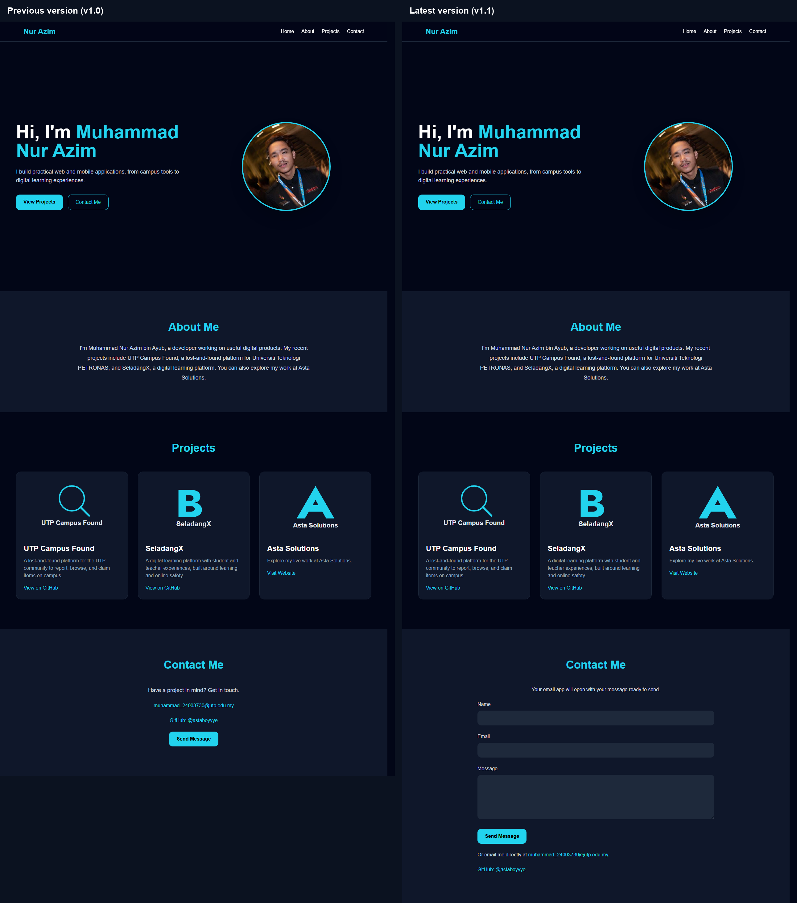

# Muhammad Nur Azim Ayub — Portfolio

A personal portfolio featuring UTP Campus Found, SeladangX, and Asta Solutions.

Live site: [finportfolioasta.vercel.app](https://finportfolioasta.vercel.app)

## Run locally

```sh
npm install
npm start
```

Open the localhost address printed by the server.

The contact form opens the visitor's email app with a composed message; the site has no server-side form handler.

## Version preview



## Projects

- [UTP Campus Found](https://github.com/astaboyyye/UTPCampusFound)
- [SeladangX](https://github.com/astaboyyye/SeladangX)
- [Asta Solutions](https://astasolutions.my)
